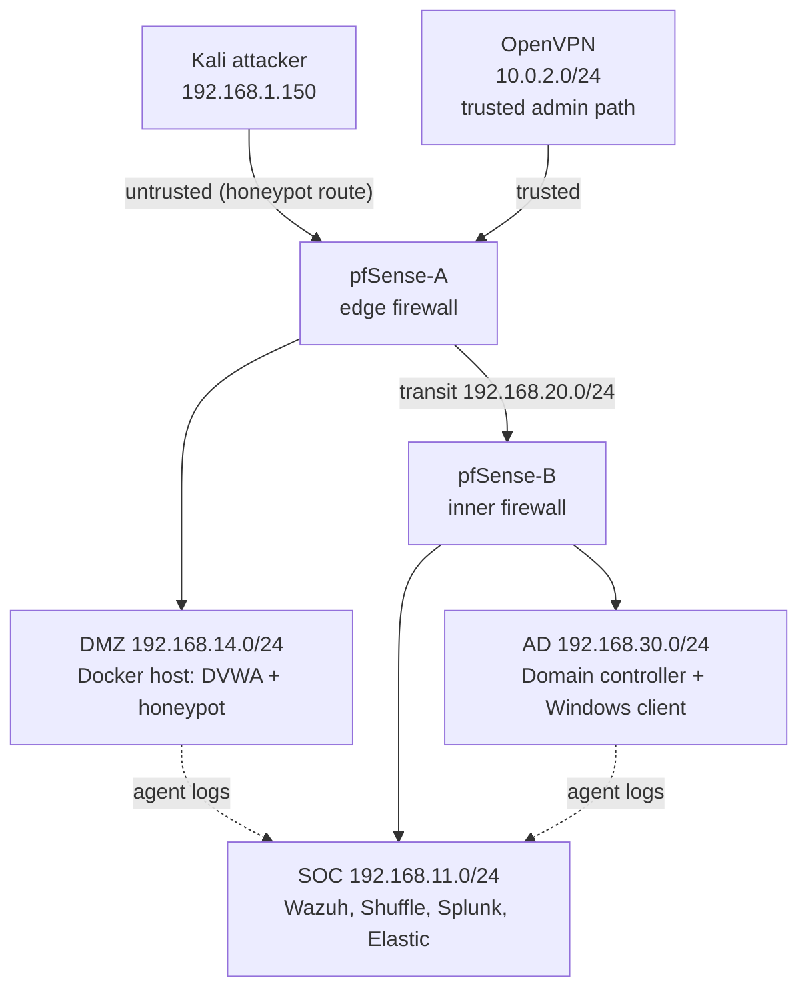

# Architecture

Two pfSense firewalls are layered. The edge firewall (pfSense-A) faces the attacker network and the DMZ. The inner firewall (pfSense-B) protects the SOC and AD zones. DMZ hosts cannot initiate connections into SOC or AD.

## IP plan

| Host | Zone | Address | Notes |
|---|---|---|---|
| Kali | Attacker | 192.168.1.150 | |
| pfSense-A WAN | Attacker | 192.168.1.1 | |
| pfSense-A DMZ | DMZ | 192.168.14.1 | |
| pfSense-A transit | Transit | 192.168.20.1 | |
| pfSense-B WAN | Transit | 192.168.20.2 | |
| pfSense-B SOC | SOC | 192.168.11.1 | |
| pfSense-B AD | AD | 192.168.30.1 | |
| Docker host (DVWA, honeypot) | DMZ | 192.168.14.10 | |
| Wazuh | SOC | 192.168.11.10 | |
| Splunk | SOC | 192.168.11.11 | |
| Shuffle | SOC | 192.168.11.12 | |
| Elastic/Kibana | SOC | 192.168.11.13 | optional, later |
| Domain controller | AD | 192.168.30.10 | |
| Windows client | AD | 192.168.30.20 | |

## Firewall intent

- Attacker to DMZ: allowed (this is the attack surface).
- Attacker to transit/SOC/AD: denied.
- DMZ to SOC/AD: denied, except agent log traffic to Wazuh (1514/1515) from the Docker host.
- AD to SOC: allowed for agent traffic to Wazuh and log forwarding.
- Admin access to SOC/AD/DMZ: via the OpenVPN path only (Phase 8). Until then, via the hypervisor console.
- Internet access for updates: a temporary NAT adapter that is removed after each install.

## Virtual network mapping

Filled in after the hypervisor decision in [build-guide/phase-0-host-check.md](build-guide/phase-0-host-check.md).
